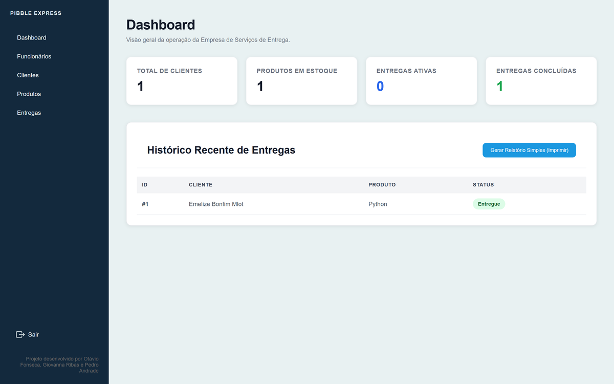
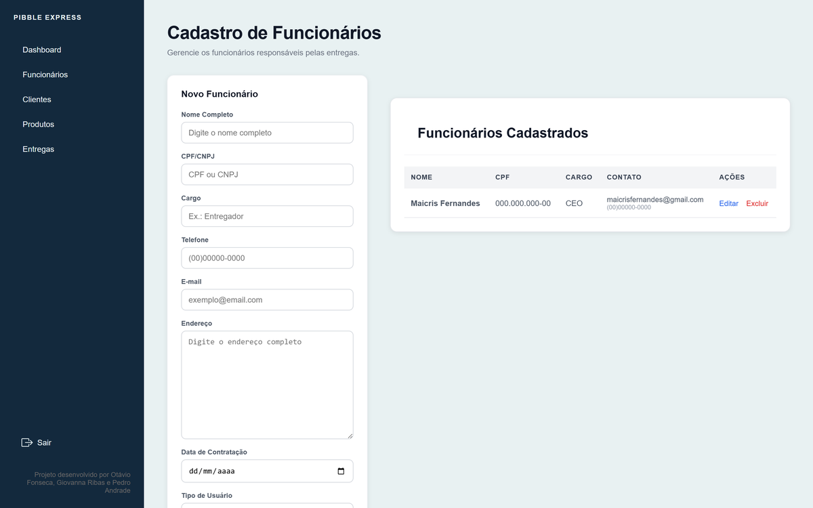

# Pibble Express

[English](README.md) · Português

[](https://github.com/ribasgiovanna/pibble_express/actions/workflows/tests.yml)

Aplicação web em Django para gestão de entregas: cadastro de clientes, produtos,
funcionários e entregas, com autenticação e níveis de acesso.

Projeto em equipe. Este é um fork do repositório original
[`rodavio/pibble_express`](https://github.com/rodavio/pibble_express), mantido na conta
da Giovanna como referência de portfólio.

| Dashboard | Módulo de funcionários |
|---|---|
|  |  |

## Equipe e responsabilidades

| Pessoa | Contribuição |
|---|---|
| Otávio ([@rodavio](https://github.com/rodavio)) | Criação e estrutura do projeto, views principais, base do CRUD |
| Giovanna Ribas dos Reis ([@ribasgiovanna](https://github.com/ribasgiovanna)) | Proposta do Django como framework; módulo de Funcionários e sua integração com Entregas; cadastro aceitando CPF e CNPJ (formulário + migration); dashboard administrativo; padronização dos formulários nos quatro apps e botão de logout |
| Pedro Henrique de Andrade de Moraes ([perfil](https://github.com/pedrooh131313)) | Ajustes gerais |

## Funcionalidades

- Autenticação de usuários (login / logout), com `LOGIN_URL` na raiz
- Níveis de acesso: cada `Funcionario` tem `tipo_usuario` `ADM` (administrador) ou `FUNC`
  (funcionário), ligado a um `User` do Django por um `OneToOneField`. O dashboard e a gestão
  de funcionários são restritos a administradores no servidor, e não só escondidos no menu
- CRUD completo de Clientes, Produtos, Funcionários e Entregas (listar / editar / excluir)
- Dashboard administrativo
- Cadastro de funcionário aceitando CPF ou CNPJ
- Máscaras nos campos dos formulários (`static/js/form-masks.js`)
- API REST (Django REST Framework) em `/api/`, via `DefaultRouter`, para os quatro recursos;
  exige login, e os dados de funcionários (CPF, endereço) são só para administradores

## Tecnologias

- Python 3, Django 6, Django REST Framework
- SQLite (desenvolvimento)
- HTML / CSS / JS nos templates

## Estrutura

```
.
├── core/              # projeto Django: settings, urls, views de login e dashboard
├── clientes/          # app: model, form, serializer, views
├── produtos/          # app
├── funcionarios/      # app (níveis de acesso ADM/FUNC)
├── entregas/          # app
├── templates/         # base, login, dashboard, telas de CRUD
├── static/            # css, js (máscaras de formulário), imagem
└── manage.py
```

## Como executar

```bash
python -m venv .venv
# Windows: .venv\Scripts\activate | Linux/Mac: source .venv/bin/activate
pip install -r requirements.txt

cp .env.example .env        # defina DJANGO_SECRET_KEY e DJANGO_DEBUG

python manage.py migrate
python manage.py createsuperuser
python manage.py runserver
```

Acesse `http://127.0.0.1:8000/`. O admin do Django fica em `/admin/` e a API em `/api/`.
O `db.sqlite3` é criado localmente pelo `migrate` e não é versionado.

`SECRET_KEY`, `DEBUG` e `ALLOWED_HOSTS` são lidos das variáveis de ambiente (com valores
padrão para desenvolvimento). Em produção, defina-os no `.env` e use `DJANGO_DEBUG=False`.

## Segurança e testes

Uma revisão do fork encontrou três falhas de controle de acesso, já corrigidas e cobertas
por testes:

| Problema | Correção |
|---|---|
| A API REST aceitava requisições sem login (a permissão padrão do DRF é `AllowAny`) | `IsAuthenticated` por padrão; o endpoint de funcionários é só para administradores |
| Usuários `FUNC` abriam a gestão de funcionários digitando o endereço, porque a restrição estava só no menu | Decorator `admin_obrigatorio` no dashboard e nas telas de funcionários; cada perfil vai para a sua página inicial depois do login |
| Os registros eram excluídos por links simples (GET), que outro site poderia disparar em nome de quem está logado (CSRF) | A exclusão aceita só POST, por formulários com token CSRF |

```bash
python manage.py test
```

A suíte também roda a cada push e pull request (GitHub Actions).

São 21 testes: formatação dos formulários (CPF/CNPJ, telefone), login e logout, níveis de
acesso, exclusão só por POST com proteção CSRF e permissões da API. Os testes de controle
de acesso foram conferidos contra o código anterior, no qual falham.
